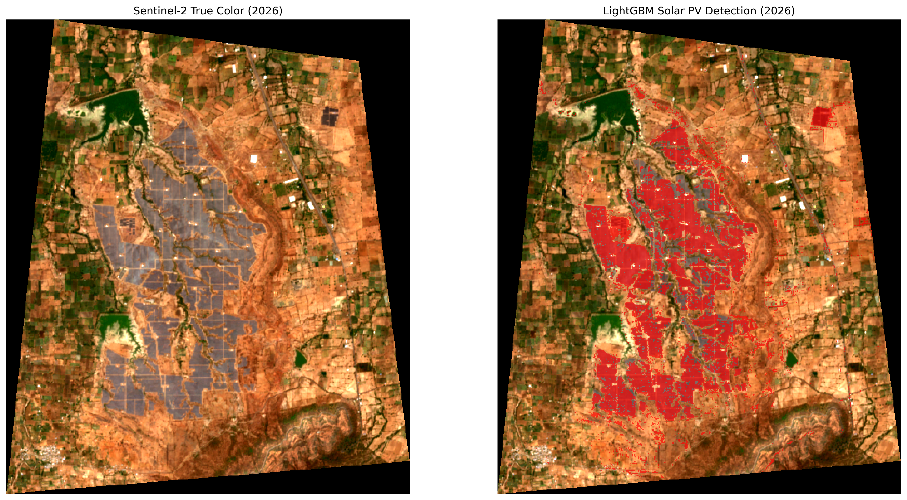
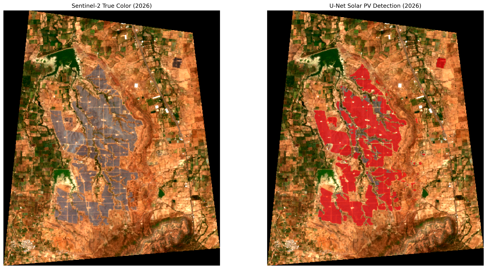

# Geospatial Land-Use Conflict Analysis Workflow

This document outlines the end-to-end workflow for replicating the LULC (Land Use Land Cover) classification and transition analysis for the Fermi Solar Farm in Jalgaon, Maharashtra. 

## Phase 1: Data Acquisition (Google Earth Engine)
1. **Define AOI**: Identify the Fermi Solar Farm boundary and draw/import the Area of Interest (AOI) geometry in Google Earth Engine (GEE).
2. **Fetch Sentinel-2 Imagery**: 
   - Define a temporal range (2017 to 2026).
   - Filter `COPERNICUS/S2_SR_HARMONIZED` collection by bounds, date, and cloud cover (< 20%).
   - Create an annual median composite for each year.
3. **Export Raw Rasters**: Export the raw multi-band images (including RGB and the SCL Scene Classification Layer) to Google Drive as GeoTIFF files with a 10m scale.

## Phase 2: Environment Setup & Feature Engineering
1. **Project Structure**: Organize the workspace into `data/` (raw, processed, vector), `notebooks/`, and `src/` (data, models).
2. **Environment**: Install required Python packages via `pip install -r requirements.txt`.
3. **Feature Engineering**: Run `python src/data/feature_engineering.py` to calculate spectral indices (e.g., NDVI, NDBI) and append them as new bands to the raw rasters.

## Phase 3: Pixel-Based Classification (Random Forest & LightGBM)
1. **Automated Label Sampling**: 
   - Run `python src/data/generate_training_labels.py`.
   - Use the native SCL embedded in the 2026 raster to extract baseline land classes (Vegetation, Bare Soil, Water).
   - Isolate solar panel footprint pixels using spatial location thresholds (high NDBI + low NDVI) within the digitized solar farm boundary.
2. **Feature Matrix Extraction**: 
   - Run `python src/data/sample_extractor.py` to extract pixel spectral values for all training coordinates.
3. **Model Training (Spatial K-Fold)**:
   - Run `python src/models/train.py` (Random Forest).
   - Run `python src/models/train_lgbm.py` (LightGBM).
   - Both models utilize Spatial Group K-Fold Cross-Validation to prevent data leakage and evaluate spatial robustness.
4. **Multi-Temporal Inference**: 
   - Run `python src/models/predict.py` and `python src/models/predict_lgbm.py` to classify all annual feature rasters (2017–2026) and generate Land Cover Transition Matrices.

## Phase 4: Semantic Segmentation (U-Net)
1. **Patch Generation**: 
   - Run `python src/data/patch_generator.py`.
   - Extract 2D sliding-window patches (128x128 pixels) from the multi-spectral feature rasters (Input X) and the classified LULC rasters (Target Mask Y).
2. **U-Net Training**: 
   - Run `python src/models/train_unet.py` to train the convolutional neural network on the generated spatial patches.
3. **U-Net Inference & Evaluation**: 
   - Run `python src/models/evaluate_saved_unet.py` to load pre-trained weights (`unet_lulc_model.pth`), perform forward passes on 2017 and 2026 rasters, and compute the pixel distributions and transition matrices.

## Phase 5: Synthesis & Land Utilization Efficiency
1. **Compare Footprints**: Aggregate the 2026 Solar/Built class area across models (RF: 294.41 ha, LightGBM: 291.12 ha, U-Net: 290.04 ha).
2. **Calculate Efficiency**: 
   - Compute the ensemble mean physical footprint (e.g., 291.86 ha).
   - Compare the mean footprint against the externally reported land acquisition boundary (e.g., Land Conflict Watch reports 445.15 ha).
   - Divide the physical footprint by the reported boundary (291.86 / 445.15) to calculate the structural land utilization efficiency (65.56%), identifying the remaining area as non-panel infrastructure, buffers, and access networks.

## Model Comparison: Random Forest, LightGBM, and U-Net

| Metric / Parameter | Random Forest | LightGBM | U-Net (CNN) | Ensemble Mean |
| :--- | :--- | :--- | :--- | :--- |
| Model Type | Bagged Decision Trees | Gradient Boosted Decision Trees | Deep Convolutional Network | Multi-Model Ensemble |
| Spatial Receptive Field | Pixel-wise (1 x 1) | Pixel-wise (1 x 1) | Spatial Neighborhood (128 x 128) | Combined |
| 2017 Baseline Built/Solar ha | 13.83 | 18.08 | 1.64 | 11.18 |
| 2026 Target Built/Solar ha | 294.41 | 291.12 | 290.04 | 291.86 |
| Net Solar Expansion Delta | +280.58 | +273.04 | +288.40 | +280.67 |
| Scrub / Grazing Commons Loss ha | 274.52 | 267.69 | 276.73 | 272.98 |
| Agricultural Cropland Loss ha | 9.19 | 11.31 | 12.42 | 10.97 |
| LCW Land Utilization Efficiency | 66.1% | 65.4% | 65.2% | 65.6% |

## Classification Overlays (2026)

### 1. Random Forest

### 2. LightGBM

### 3. U-Net (CNN)

